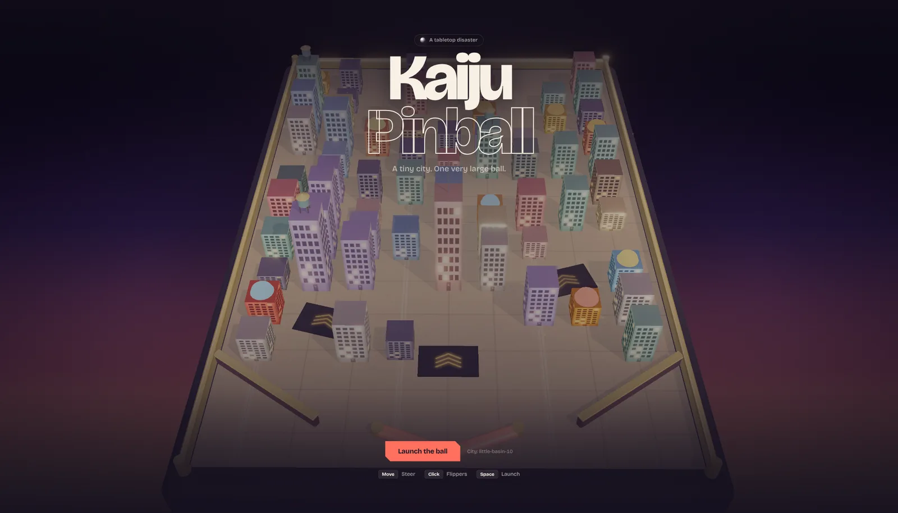
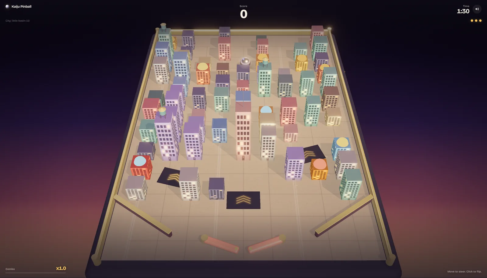
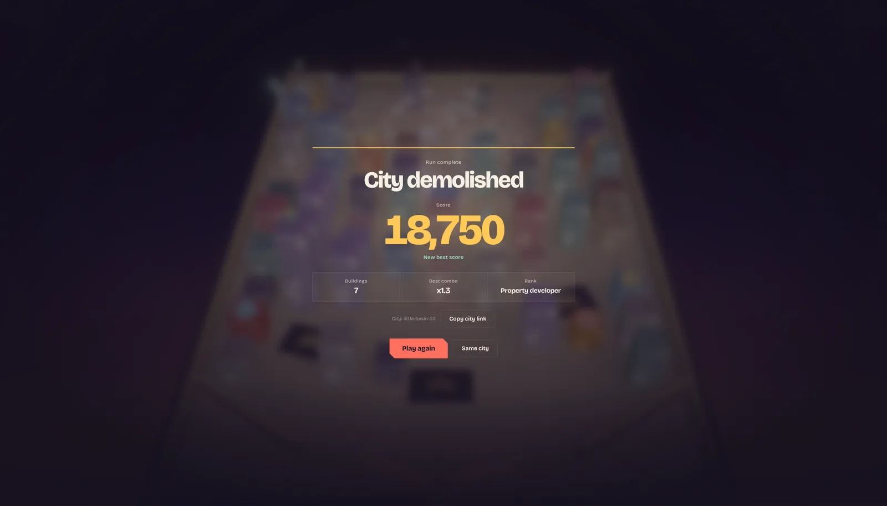

# Kaiju Pinball

A tiny city, one very large ball, and ninety seconds of beautiful destruction.

[Play the live demo](https://jimmerioles.github.io/kaiju-pinball/) · [Architecture](docs/architecture.md) · [Agent handoff](AGENTS.md)

[](https://github.com/jimmerioles/kaiju-pinball/actions/workflows/ci.yml)
[](https://github.com/jimmerioles/kaiju-pinball/actions/workflows/pages.yml)
[](LICENSE)



Kaiju Pinball is a browser toy built with three.js. You steer a chrome ball through a seeded miniature city that doubles as a pinball table. Buildings crack and collapse into shards, glowing caps launch the ball across the table, and angled inlane guides funnel it back toward the flippers. Every hit inside a short window builds a multiplier. A local best score gives you a reason to come back.

## Watch the explainer

<video src="https://github.com/user-attachments/assets/df40737f-a1aa-4c69-b51e-06a8242c2120" controls playsinline poster="https://raw.githubusercontent.com/jimmerioles/kaiju-pinball/main/docs/screenshots/explainer.webp">
  <a href="https://github.com/user-attachments/assets/df40737f-a1aa-4c69-b51e-06a8242c2120">Watch the five-minute explainer</a>
</video>

A five-minute visual explainer in the spirit of 3Blue1Brown: the table and the city as two maps, the seed, the collision math, the 120 Hz step, chains and combos, and the browser rendering budget. Narrated with Kokoro `af_heart`, animated with Manim, and built from the same constants as the game. [Full 1080p download](docs/video/kaiju-pinball-explainer.mp4) · [Captions](docs/video/kaiju-pinball-explainer.srt).

The explainer is documentation, not a runtime asset. The game itself still ships with no external models, textures, or audio.

## Run it

```bash
npm ci
npm run dev
```

Node 22.12 or newer. `.nvmrc` pins Node 24. Open the local URL Vite prints, usually `http://localhost:5173`.

```bash
npm run build
npm run preview
```

## Controls

- **Move the pointer** or press **A** / **D** to steer.
- **Click** the left or right half of the screen to fire that flipper. **Z** and **M** also work, as do the Shift keys.
- **Space** launches the ball from the start screen.
- The game runs for ninety seconds with three balls.
- A five second ball saver protects the first drain of each ball.

## Seeds

The city is generated from a seed. The current seed appears in the HUD and on the end screen. Add `?seed=peach-harbor-42` to the URL to revisit a city, or use **Copy city link** after a run.

**Daily run** on the start screen loads a city seeded from today's local date. It changes at midnight and shares like any other seed.

The start screen also keeps the five most recent cities launched on this browser. Pick one to play it again.

## Screens

| Gameplay                                    | End of a run                                    |
| ------------------------------------------- | ----------------------------------------------- |
|  |  |

## Development

```bash
npm run check   # strict TypeScript
npm run lint    # ESLint, zero warnings
npm test        # Vitest
npm run build   # production bundle
npm run format  # Prettier
```

`npm run verify` runs lint, tests, formatting check, and build in one pass.

## How it is built

- Vite, TypeScript, and three.js with no external models, textures, or audio files.
- Seeded city generation with one `InstancedMesh` for buildings and one for bumper caps.
- A small custom ball integrator with fixed 120 Hz substeps and sphere versus AABB collisions.
- Instanced shards, shader particle pools for sparks and dust, additive shockwave rings, and synthesized Web Audio impacts.
- `EffectComposer` with bloom, a vignette, and film grain.
- A DOM HUD over a single WebGL canvas, with shareable seeds, a daily seed shortcut, recent-city history, and a local best score.

The full story lives in [`docs/plan.md`](docs/plan.md). The implementation map is in [`docs/architecture.md`](docs/architecture.md).

## Docs

- [`docs/plan.md`](docs/plan.md): the product idea, build plan, and status.
- [`docs/architecture.md`](docs/architecture.md): runtime flow, simulation, rendering, and extension recipes.
- [`GLOSSARY.md`](GLOSSARY.md): the shared vocabulary for the game.
- [`docs/adr/`](docs/adr/): the decisions that are expensive to revisit.
- [`docs/video/kaiju-pinball-explainer.mp4`](docs/video/kaiju-pinball-explainer.mp4): the five-minute explainer in 1080p.
- [`AGENTS.md`](AGENTS.md): the entry point for a fresh coding agent.

## Project layout

```
src/
  main.ts
  style.css
  game/
    game.ts       orchestration, physics, scoring, camera
    city.ts       table, seeded city, boost pads, guides, lamps, roof details
    ball.ts       chrome ball, custom environment, contact shadow
    flippers.ts   flipper geometry and collisions
    effects.ts    shards, particles, shockwave rings
    audio.ts      synthesized sound effects and ambience
    input.ts      keyboard, pointer, and touch controls
    ui.ts         HUD, start screen, end screen, callouts
    config.ts     table, ball, and game tuning
    rng.ts        seed hashing, daily seed, and random generation
    seed-history.ts recent-city storage and dedupe
docs/
  adr/            architecture decision records
  screenshots/    README images
  video/          explainer video and captions
  plan.md         product plan
  architecture.md implementation reference
```

## Deployment

Pushes to `main` deploy the static build to GitHub Pages through `.github/workflows/pages.yml`. The build uses a relative base, so it also works on Netlify, Cloudflare Pages, or any static host.

## Notes

The project favours arcade feel over rigid body realism. Buildings fracture into a handful of chunky shards, chain reactions are scheduled rather than simulated, and the ball uses a hand tuned integrator so it stays fast and predictable.

## License

MIT. See [`LICENSE`](LICENSE).
