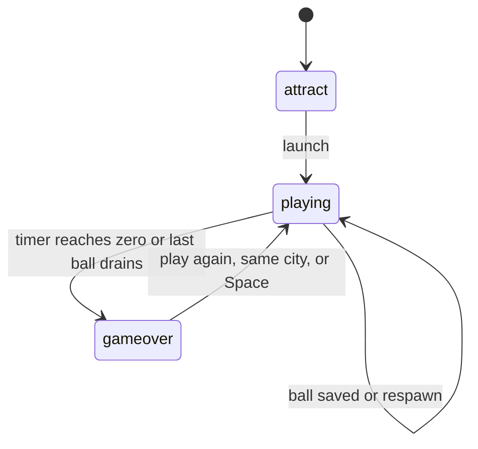

# Architecture

Kaiju Pinball is a single-page Vite game. The DOM owns the HUD and overlays. A three.js canvas owns the world. City layout is deterministic from a seed. Ball physics is arcade, not rigid body.

## Runtime map

```
main.ts
  └─ Game
      ├─ Scene, PerspectiveCamera, WebGLRenderer, EffectComposer
      ├─ City
      ├─ Ball
      ├─ FlipperPair
      ├─ Effects
      ├─ AudioEngine
      ├─ Input
      └─ UI
```

## Frame loop

`Game.frame()` clamps `clock.getDelta()` to 50 ms, calls `Game.update(dt)`, updates the vignette time uniform, and renders the composer.

`update` branches on state:

- **attract:** city and effects animate, the camera sways, the ball stays hidden.
- **playing:** timer, combo, flippers, fixed-step ball physics, chain queue, effects, camera.
- **gameover:** time scales toward 0.18, city and effects slow, the camera orbits, the end screen appears after 900 ms.

Physics uses a fixed step:

```
accumulator += dt
while accumulator >= 1/120 and steps < 8:
  stepBall(1/120)
  accumulator -= 1/120
```

The step is small enough that no visual interpolation is needed at 60 fps.

## State machine



`startRun(seed, regenerate)` is the only entry to a run. It resets score, combo, balls, timer, effects, ball, flippers, and the URL seed. It refuses to start while a run is already playing. `endRun()` is idempotent.

## Simulation

### Ball

- `position` and `velocity` are `Vector3`. Gravity is `(0, -38, +9)`, a steep table pull plus a downward component.
- The ball rolls on the table at `y = radius`. Table restitution is 0.46.
- Wall limits are `x = ±(11.8 - radius)` and `z = topZ + radius`. The bottom is open and drains at `z > 15.2`.
- `stepBall` order: gravity, steering, integrate, table, walls, drain, city AABBs, guides, flippers, pads, speed clamp.
- Speed is clamped to 40. The 120 Hz step keeps a 0.66 radius ball from tunneling through 0.35 thick walls. Thinner geometry needs a smaller step or swept collision.

### City collision

- Every block stores an AABB in `min` and `max`.
- `resolveSphereAABB` finds the closest point on the box. When the sphere center is inside, it picks the nearest face.
- On contact the ball is pushed out along the normal, the normal velocity is reflected with restitution 0.48 (0.92 for bumpers), and impact speed drives damage.
- `City.forEachNear` uses the generation grid to visit only blocks near the query point.

### Guides and flippers

- Guides are line segments with a 0.3 collision radius. `collideWithSegment` reflects in XZ and flips the normal toward `guide.inside`, so the outlanes cannot trap the ball.
- Flippers are capsules approximated by a segment from pivot to tip. `Flipper.collide` pushes the ball out and applies a lift impulse based on angular speed.
- Flipper fire is a 0.16 second pulse, not a held state.
- The flipper animation uses `MathUtils.damp` at rate 28. Collision uses the current angle.

### Boost pads

- Three pads are defined in `City.buildPads`.
- A pad triggers when the ball is within `pad.radius` in XZ and below `y = 1.25`.
- It applies a 16 unit impulse along its direction, lifts `vy` to at least 5.5, starts a 0.8 second cooldown, and awards 50 base points.

### Damage, destruction, and chains

- Health is 1 for fragile, 3 for solid, and 2 for bumper.
- Impact damage is `max(0.35, (impactSpeed - 1) * 0.38)`.
- `damageBlock` reduces health, flashes the instance color, and calls `destroyBlock` at zero.
- `destroyBlock` zeroes the instance matrix, hides the cap if present, and leaves the block in the arrays as inactive.
- Destroying a block queues up to 8 neighbors within 3.0 units for 1.05 chain damage after 40 to 140 ms. Chains can nest to depth 2.
- Chain kills add `70 + chainCount * 25` base points and show a "Chain xN" callout at 3, 6, and 10.
- Shards are visual only. Chain reactions are scheduled. This is deliberate; see ADR 0001.

### Scoring

- Base points: hit 20, destroy 120, bumper 250, pad 50, chain 70 plus 25 per chain count.
- `multiplier = min(12, 1 + combo * 0.25)`.
- Combo increases on every damaging hit and resets after 2.6 seconds without one.
- Milestones fire at combo 5, 10, 20, 30, 45, and 60.
- The best multiplier is shown as "Best combo" on the end screen.
- Ranks: under 6k Concerned neighbor, under 16k Rowdy tenant, under 30k Property developer, under 50k Act of God, otherwise Kaiju.
- Best score persists in `localStorage` under `kaiju-pinball-best`.

### Ball save and drain

- `launchBall(allowSave = true)` starts a 5 second save window.
- The first drain inside the window consumes the save, keeps the ball count, shows "Ball saved", and relaunches after 0.8 seconds with no save.
- Later drains decrement `ballsLeft`, show "Ball lost", and relaunch after 1.05 seconds with a fresh save for the next ball.
- Losing the last ball ends the run. The timer also ends the run at zero.

## Rendering

### Scene and camera

- Perspective camera, 38 degree FOV.
- Base position is `(0, 31, 31)` scaled by `cameraFit`. Look target is `(0, 0, 1.4)`.
- `cameraFit` is 1 on landscape. On portrait it is `min(2.1, 0.94 / aspect)`, which fits the table width.
- Sun is a warm directional light at `(14, 26, 12)` with a 2048 shadow map. A hemisphere fill and a cool back fill finish the light.
- `RoomEnvironment` PMREM lights the city materials. The ball overrides this with a procedural equirectangular chrome map.

### Post-processing

- `EffectComposer` runs RenderPass, UnrealBloomPass, OutputPass, then a vignette and grain ShaderPass.
- Bloom is strength 0.35, radius 0.45, threshold 0.9.
- Tone mapping is ACES, exposure is 0.9, output is sRGB.
- The particle shader is a custom `ShaderMaterial` with per-particle size, alpha, and color. Sparks are additive. Dust uses normal blending.

### City rendering

- One `InstancedMesh` holds every building with a material array for sides, roof, and bottom.
- One `InstancedMesh` holds the bumper caps.
- Facade and emissive window textures are generated per seed and swapped into `sideMaterial`.
- Street texture, pad plates, guide bodies, rim, plinth, and under-shadow are built once.
- Lamps are two `Points` clouds sharing one geometry.
- Roof details are a small group of shared meshes.
- Destroyed blocks are hidden by zeroing the instance matrix. Bumper caps pulse by updating one matrix per active cap.

### Effects

- Shards: one `InstancedMesh` of 420 boxes with gravity, table bounce, and a scale-out at the end of life.
- Sparks: 900 shader particles, additive, short life.
- Dust: 320 shader particles, normal blend, larger and slower.
- Rings: 20 additive ring meshes with per-ring material opacity.
- All pools are fixed size and reused. No meshes are allocated per impact.

### Ball

- Sphere radius 0.66, metalness 1, roughness 0.16.
- A 512 by 256 equirectangular environment from `makeChromeEnvironment()` gives dark caps and a bright horizon.
- The contact shadow is a radial texture plane.
- The halo sprite uses `depthTest: false` so the ball can be tracked behind towers.

## City generation

- `makeRng(seed)` hashes the seed with FNV-1a and drives mulberry32.
- Grid: 9 columns by 13 rows at 2.45 spacing. Rows above `z = 10.4` and the top launch lane are skipped. Pads reserve a 2.25 radius.
- Density is 0.72. Type roll: bumper under 0.09, solid under 0.36, otherwise fragile.
- Heights: fragile 1.2 to 4.0 with a 7 percent chance of a 5.2 to 7.4 tower, solid 0.9 to 2.8, bumper 1.0 to 2.1.
- Footprint is 1.34 to 1.60. Buildings sit at their cell center with up to 0.07 jitter.
- Colors come from `PALETTE` with HSL jitter. The facade texture has 4 by 8 windows with 27 percent lit.
- Roof details: an antenna on the tallest block and water towers on up to three more tall blocks.
- Lamps follow grid lines with 20 percent probability and skip pads.
- `clearGenerated()` removes buildings, caps, lamps, roof details, and per-seed textures before a regenerate.

## Input and UI

- Input listens on `window` and ignores interactive targets such as buttons and screens.
- Keyboard: A and D or the arrow keys steer. Z and M or the Shift keys fire flippers. Space launches unless a button or link has focus, so start and end screen actions activate natively.
- Pointer: horizontal position steers with a dead zone. A click fires the flipper on that half. Touch drag steers and a tap fires.
- UI is a DOM layer over the canvas. HUD updates write strings only when values change.
- Popups project world positions with the camera at spawn time. Callouts are centered and capped at three.
- The URL seed is updated with `history.replaceState` on every run. `?seed=` is read on load.
- **Daily run** starts a seed of the form `daily-YYYY-MM-DD` from the local calendar date. It is a normal shareable seed after launch.
- Starting a run records the seed in a JSON array under `kaiju-pinball-recent-seeds`. The start screen shows up to five recent cities as launch chips.
- Best score is read and written in `localStorage`. Storage failures are silent.

## Performance and limits

- Pixel ratio is capped at 1.75.
- Bloom runs at viewport resolution. Lower the pixel ratio before raising bloom.
- Shadow map is 2048 squared with one directional light.
- Fixed budgets: 420 shards, 900 sparks, 320 dust, 20 rings, 3 pads, roughly 90 buildings.
- The city is about 3 draw calls plus lamps and roof details. Effects add 4 to 6 draw calls.
- The main risk is bloom on integrated graphics. Test at 1080p with a 1.5 pixel ratio if it stutters.

## Extension recipes

### Add a city theme

1. Add a palette set to `config.ts`.
2. Thread a theme choice into `City.regenerate`.
3. Adjust facade and street colors in `makeFacadeTextures` and `makeStreetTexture`.
4. Add a screenshot and a seed example to the README.

### Add a block type

1. Extend `BlockKind`, the type roll, health, height, and palette.
2. Add rendering through instance color or a new instanced mesh.
3. Add collision behavior in `collideWithBlock`.
4. Update `GLOSSARY.md` and the end-screen copy if scoring changes.
5. Run the completion checklist and test at least two seeds.

### Add an effect

1. Add a fixed-size pool to `Effects`.
2. Update it in `Effects.update(dt)`.
3. Spawn it from one of the existing feedback points.
4. Keep it within the visual palette and the draw-call budget.

## Testing and verification

- `npm run check`: strict TypeScript.
- `npm run lint`: ESLint with zero warnings.
- `npm test`: Vitest, covering deterministic seeding, the seed-to-city layout contract, sphere and guide collision math, table config invariants, daily seeds, and recent-seed history.
- `npm run build`: production build.
- Manual: use a visible browser tab. Background tabs pause `requestAnimationFrame` and make the game look frozen.
- The dev server may choose a different port if 5173 is busy. Read the printed URL.

## Deployment

- Static Vite build with `base: './'`.
- GitHub Actions runs CI on push and pull request, and deploys Pages on push to main.
- Pages URL: `https://jimmerioles.github.io/kaiju-pinball/`.
- There is no server, database, or environment variable. Seeds live in the URL.

## Case study

- `case-study.html` is a second static page in the same Vite build. It does not load three.js.
- `index.html` redirects `#/case-study` to the page so the Throughline-style deep link still works.
- `src/case-study.css` owns the page. It shares the game palette and Bricolage Grotesque.
- `vite.config.ts` lists both HTML entries under `build.rollupOptions.input`.
- Screenshots come from `docs/screenshots/`. The explainer is a release asset, not a repository file.
